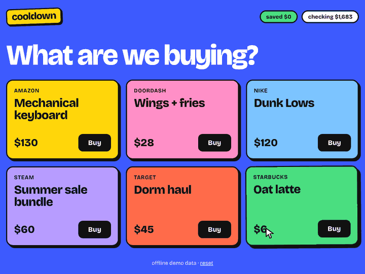

# cooldown

A speed bump for impulse buys. Built at HackNC 2026 for Capital One's "Best Use of Nessie" track.



You hit Buy, and instead of buying, you get a countdown. How long you wait depends on your actual
purchase history in [Nessie](https://api.nessieisreal.com): a 1am Amazon order when you've already
ordered twice this week gets about 18 seconds, and a morning latte gets 5. While the timer runs,
the "Buy it anyway" button runs away from your cursor.

If you skip it, the money moves into savings in your Nessie sandbox.

## How it works

1. **Store.** Six things you probably don't need, each with a Buy button.
2. **Countdown.** The app checks your Nessie purchases and shows the two strongest reasons to wait:
   - it's late, and most of your spending at that store happens late
   - you've already bought from there this week
   - it's way bigger than what you usually spend
   - it's from an impulse category (delivery, shopping, games)
   - it's a big chunk of what's left in checking
3. **Saved.** Skipping writes a transfer out of checking and a deposit into savings. The saved
   total is rebuilt from those Nessie deposits every time you load the page.

## Run it

```bash
npm install
echo "VITE_NESSIE_KEY=your_key_here" > .env.local
npm run dev
```

Get a key at [nessieisreal.com](https://prod.nessieisreal.com). **Start with Nessie** creates a
customer, checking and savings accounts, 9 merchants, and about a month of fake purchase history in
your sandbox. With no key, it runs on offline demo data instead.

**Demo tip:** add `?hour=1` to the URL to pretend it's 1am. The late-night check is the best one.

## Nessie endpoints

| | |
| --- | --- |
| Setup | `POST /customers`, `POST /customers/{id}/accounts`, `POST /merchants` |
| History | `GET` / `POST /accounts/{id}/purchases` |
| Skipping | `POST /accounts/{id}/transfers` + `POST /accounts/{id}/deposits` |
| Saved total | `GET /accounts/{id}/deposits` |
| Balance | `GET /accounts/{id}` |

## Things we learned about Nessie

The current API doesn't match the old docs, so we found these by testing it directly:

- Purchases, transfers, and deposits never change an account's balance, so the app does the math itself.
- Amounts are stored as whole dollars ($12.50 comes back as $12).
- Transfers don't have a destination account, so moving money to savings takes a transfer *and* a deposit.
- Purchases have a date but no time. We add the time to the description (`"Wings @23:41"`) so the
  late-night check works.
- It only answers on HTTPS now. Plain `http://` gets refused.

## Code

- `src/bank.ts`: Nessie client, plus `DemoBank`, an offline copy that behaves the same way
  (quirks included) so the demo still works if the wifi dies.
- `src/regret.ts`: picks the reasons and the countdown length.
- `src/model.ts`: merchants, seeding the sandbox, parsing Nessie data.
- `src/App.tsx`: the three screens.

React + TypeScript + Vite. No backend; Nessie allows browser requests directly.
